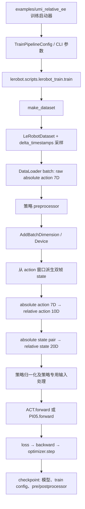
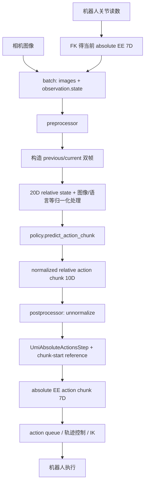

# UMI Relative EE：训练与推理流程说明

本文以 `examples/umi_relative_ee` 为入口，说明 ACT 与 π0.5 在本项目中的数据表示、训练和部署推理调用链。代码链接指向仓库内对应实现。

## 结论速览

1. **模型输出是归一化空间中的相对动作，不是绝对位姿。** 在本配置下策略动作维度为 10；推理后先经过 postprocessor 反归一化，随后由 `UmiAbsoluteActionsStep` 结合当前 chunk 的参考位姿解码为绝对 7D EE 目标。
2. **10D** 是一个相对 EE 动作/位姿：`[dx, dy, dz, rot6d(6), gripper]`。**20D** 是两帧相对状态拼接：`[relative(previous, current), relative(current, current)]`，每段 10D。
3. 磁盘原始 action 保持绝对 7D。训练时 processor 将采样 batch 转成策略使用的 10D action 和 20D state；原始数据不会被就地改写。
4. ACT 与 π0.5 共用 UMI 几何变换和通用训练循环。区别主要在策略架构、归一化/输入准备、π0.5 的语言 token 输入、flow-matching 采样与训练参数，以及 π0.5 通常较高的推理成本。

## 1. 模型原始输出是绝对还是相对位姿？

**是相对位姿/动作。** 更精确地说，策略输出的是归一化空间的 10D 相对动作序列；它本身还不是可直接发给机器人的绝对 EE 目标。推理 postprocessor 的顺序是：

```text
policy 输出（normalized relative 10D）
  → UnnormalizerProcessorStep（反归一化，仍是 relative 10D）
  → UmiAbsoluteActionsStep（结合 chunk-base state，解码为 absolute 7D）
  → DeviceProcessorStep(cpu)
```

代码依据：

- UMI 动作定义和绝对/相对转换：[umi_relative_ee_processor.py](../../src/lerobot/processor/umi_relative_ee_processor.py#L1)
- ACT 后处理管线：[processor_act.py](../../src/lerobot/policies/act/processor_act.py#L41)
- π0.5 后处理管线：[processor_pi05.py](../../src/lerobot/policies/pi05/processor_pi05.py#L105)
- 绝对动作 processor 使用 preprocessor 缓存的状态作为参考：[umi_relative_ee_processor.py](../../src/lerobot/processor/umi_relative_ee_processor.py#L268)
- Piper 部署中模型输出与 postprocessor 调用：[deploy_umi_relative_ee_piper.py](./deploy_umi_relative_ee_piper.py#L913)

对一个相对动作 `r` 和参考 EE 绝对位姿 `T_ref`，代码计算 `T_abs = T_ref @ T_rel`。平移是在参考 EE 坐标系下表达；旋转由 row-based rot6d 重建；gripper 值直接保留。公式实现见 [`relative_rot6d_to_absolute_aa`](../../src/lerobot/processor/umi_relative_ee_processor.py#L85)。

> “模型输出”与“部署动作”不要混为一谈：模型输出相对 10D；postprocessor 的最终输出才是绝对 7D。

## 2. 10D 和 20D 表示是什么？

### 10D 相对动作

```text
[dx, dy, dz, rot6d_0, rot6d_1, rot6d_2, rot6d_3, rot6d_4, rot6d_5, gripper]
 \_____ 平移 _____/ \________ 相对旋转 ________/ \夹爪/
```

它描述目标 EE pose 相对于参考 pose 的变换。磁盘 action 是 `[x,y,z,axis-angle(3),gripper]` 绝对 7D，processor 将其转换成 10D 相对动作，具体见 [`to_umi_relative_actions`](../../src/lerobot/processor/umi_relative_ee_processor.py#L111)。

rot6d 是旋转矩阵前两行的 6 个数，不是 axis-angle，也不是 6 个独立旋转角。矩阵与 rot6d 的转换见 [`matrix_to_rot6d`](../../src/lerobot/processor/umi_relative_ee_processor.py#L65) 和 [`rot6d_to_matrix`](../../src/lerobot/processor/umi_relative_ee_processor.py#L70)。

### 20D 相对状态

输入是两帧绝对 EE pose：`[previous, current]`，每帧原本 7D。以 current 为参考，把两帧都转换为相对位姿后拼接：

```text
rel_previous = inverse(T_current) @ T_previous  → 10D
rel_current  = inverse(T_current) @ T_current   → 10D identity
state20      = [rel_previous, rel_current]       → 20D
```

`to_umi_relative_state` 直接实现上述计算并 flatten：[umi_relative_ee_processor.py](../../src/lerobot/processor/umi_relative_ee_processor.py#L133)。因此第二段在理想情况下是平移零、旋转 identity、gripper 为 current gripper。注意实现的 `absolute_aa_to_relative_rot6d` 在结果中使用 target 的 gripper 值。

如果数据 batch 中没有 `observation.state`，训练 processor 会从时间窗 action 派生 `[action(t-1), action(t)]` 作为两帧状态；`UmiDeriveStateFromActionStep` 同时丢掉 action 窗口第一个元素，使输入 state 与监督目标动作时间对齐：[umi_relative_ee_processor.py](../../src/lerobot/processor/umi_relative_ee_processor.py#L145)。

## 3. 原始数据进入训练框架的数据流

### 流程图



### 入口与调用跳转

示例目录中的三个训练脚本通过本目录的 [Reach AnyPoint 适配器](./reach_anypoint_dataset.py) 将配置交给标准 trainer。适配器仅在训练调用期间替换 trainer 的数据集工厂：带 manifest 的数据使用独立规划轨迹，普通数据仍交给标准工厂；结束或报错后恢复原始工厂，不修改 `src/` 文件。标准 `lerobot-train` 不读取这些额外标注。

- [train_relative_ee_processor.py](./train_relative_ee_processor.py#L1)
- [train_umi_relative_ee.py](./train_umi_relative_ee.py#L1)
- [train_pi05_lora.py](./train_pi05_lora.py#L1)
- 通用训练入口：[lerobot_train.py](../../src/lerobot/scripts/lerobot_train.py#L301)

`TrainPipelineConfig.validate()` 根据 `--policy.path` 加载策略配置及覆盖参数：[configs/train.py](../../src/lerobot/configs/train.py#L127)。`train()` 调用 `make_dataset()`、`make_policy()` 和 `make_pre_post_processors()`，构造数据、模型和 processor：[lerobot_train.py](../../src/lerobot/scripts/lerobot_train.py#L350)。

`make_dataset()` 会验证 UMI 模式支持的策略类型、要求非 streaming 数据和原始 ACTION shape 为 7；训练数据统计会补充 UMI 相对动作统计，并把供策略使用的 metadata feature 设为 ACTION 10D / STATE 20D：[datasets/factory.py](../../src/lerobot/datasets/factory.py#L69)、[UMI stats 与 feature 更新](../../src/lerobot/datasets/factory.py#L150)。这些 metadata 更新并不等于改写磁盘上的原始 episode。

训练循环从 DataLoader 取出 batch，先将 uint8 相机图像转 float，再调用 preprocessor，最后将结果传给 `update_policy()`：[lerobot_train.py](../../src/lerobot/scripts/lerobot_train.py#L163)、[训练 batch 调用](../../src/lerobot/scripts/lerobot_train.py#L607)、[更新参数](../../src/lerobot/scripts/lerobot_train.py#L35)。ACT/π0.5 的 forward 读取处理后的 ACTION 计算 loss：[ACT forward](../../src/lerobot/policies/act/modeling_act.py#L137)、[π0.5 forward](../../src/lerobot/policies/pi05/modeling_pi05.py#L1290)。

### 训练中的输入、监督目标和处理边界

| 边界 | `action` | `observation.state` | 说明 |
|---|---|---|---|
| 磁盘原始数据 | absolute 7D `[xyz, axis-angle, gripper]` | 可能不存在，或数据采集时保存的状态 | 源数据表示；不会被本流程就地覆盖 |
| Dataset 时间窗采样后 | 一段绝对 7D action 序列 | 依 dataset feature 可能缺失 | timestamp 由策略的 action/state delta indices 决定 |
| UMI preprocessor 几何变换后 | relative 10D action chunk | relative 20D 双帧 state | 这是策略监督目标与 proprioceptive 输入 |
| Normalize / 策略专用处理后 | normalized relative 10D | normalized relative 20D；PI0.5 还会准备状态 token、语言 token | 真正进入模型的 batch |
| 模型训练输出 | ACT 预测 action chunk；PI0.5 预测 flow/action 相关量以计算训练 loss | 不适用 | loss 对比处理后的 target；不是绝对 7D |

训练过程通常不会对模型的预测调用 action postprocessor；postprocessor 主要用于推理时把模型动作转换回物理单位和绝对坐标。Checkpoint 保存模型和 processor 配置，保存调用见 [lerobot_train.py](../../src/lerobot/scripts/lerobot_train.py#L660) 与 [train_utils.py](../../src/lerobot/common/train_utils.py#L69)。

## 4. 模型推理的数据流

### Piper 同步部署流程图



真实部署加载的是 checkpoint 中的 policy config、模型权重和 processor 配置：[load_policy_and_processors](./deploy_umi_relative_ee_piper.py#L401)。π0.5 会由 [`add_policy_task`](./deploy_umi_relative_ee_piper.py#L416) 把必需的 task 字符串加入 batch；ACT 不需要 task。

主循环里，机器人 FK 得到当前 EE 绝对位姿，相机帧加入 batch；preprocessor 每个控制 tick 都被调用以更新两帧状态。仅当动作队列空时，调用 `policy.predict_action_chunk(processed)`，再以**一次 postprocessor 调用处理整块动作**：[deploy_umi_relative_ee_piper.py](./deploy_umi_relative_ee_piper.py#L890)。此处先得到 `pred_norm`（normalized relative），再得到 `pred` / `actions_aa`（absolute 7D），然后放进 queue。该实现刻意保持整块共用一个 chunk 起始参考位姿。

同步部署下，`UmiRelativeStateStep` 接收 `[B,7]` 单帧状态时，用自身持久状态缓存上一帧；首帧令 previous=current：[umi_relative_ee_processor.py](../../src/lerobot/processor/umi_relative_ee_processor.py#L222)。重置 episode/策略时也需要 reset preprocessor 与 postprocessor 缓存。

部署循环的返回边界：

| 阶段 | 典型表示/形状 | 说明 |
|---|---|---|
| FK 与相机采集 | state `[B,7]`；images `[B,C,H,W]` | 当前绝对 EE pose 与当前图像 |
| preprocessor 输出 | state `[B,20]`，policy-specific images/tokens | 输入模型的 feature 已处理、归一化 |
| `predict_action_chunk` 输出 | `[B,T,10]`，normalized relative | 预测动作块；π0.5 先从 padded action dimension 裁剪回 feature dim |
| postprocessor 中间结果 | `[B,T,10]`，unnormalized relative | 仍然是相对表示 |
| postprocessor 最终结果 | `[B,T,7]` absolute `[xyz, axis-angle, gripper]` | 以生成此块时缓存的状态为参考 |
| 控制端 | action queue 中的 absolute target | 后续轨迹插值/IK/机器人接口处理 |

### `predict_action_chunk` 与 `select_action` 的差别

ACT 与 π0.5 都提供 `predict_action_chunk()` 和 `select_action()`。`select_action()` 通常从策略自己的 action queue 每次吐出一个 action；UMI Piper 的自定义部署直接调用 `predict_action_chunk()`，外层动作队列保存 postprocessed 的 absolute actions。这样可一次性解码完整 chunk，避免每个单动作调用时参考位姿发生漂移。

- ACT chunk 预测：[modeling_act.py](../../src/lerobot/policies/act/modeling_act.py#L126)；单动作队列：[modeling_act.py](../../src/lerobot/policies/act/modeling_act.py#L101)
- π0.5 chunk 预测：[modeling_pi05.py](../../src/lerobot/policies/pi05/modeling_pi05.py#L1273)；单动作队列：[modeling_pi05.py](../../src/lerobot/policies/pi05/modeling_pi05.py#L1256)

## 5. ACT 和 π0.5 训练及部署推理的区别

### 共同点

- 都使用 raw absolute 7D dataset action，并由 UMI processor 派生 10D relative action 和 20D state。
- 都进入同一标准训练循环；示例脚本只包一层 `train(cfg)`。
- 都通过 checkpoint 加载同一类 UMI pre/postprocessor；预测 chunk 的 postprocessor 输出为 absolute 7D。
- chunk 内目标共用 chunk-start reference，这个坐标约定在训练目标与部署动作解码中保持一致。

### 差异表

| 方面 | ACT | π0.5 |
|---|---|---|
| 模型类型 | 视觉/状态条件的 Action Chunking Transformer；输出动作 chunk | VLA + action expert；用 flow matching 生成动作 chunk |
| UMI processor | Rename、batch、device；UMI derive/action/state；Normalizer。见 [ACT processor](../../src/lerobot/policies/act/processor_act.py#L41) | Rename、batch；UMI derive/action/state；Normalizer；state tokenizer、PaliGemma tokenizer、device。见 [PI05 processor](../../src/lerobot/policies/pi05/processor_pi05.py#L105) |
| 默认归一化 | ACTION/STATE 默认 MIN_MAX 配置；是否 identity rot6d 由 `umi_rot6d_identity_norm` 等配置决定。见 [ACT config](../../src/lerobot/policies/act/configuration_act.py#L91) | ACTION/STATE 默认 QUANTILES；也可由配置选择 rot6d identity normalization。见 [PI05 config](../../src/lerobot/policies/pi05/configuration_pi05.py#L60) |
| 语言任务 | 不要求 `task` 输入 | 需要 task 文本；部署 helper 会检查并将它放入 batch：[deploy helper](./deploy_umi_relative_ee_piper.py#L416) |
| 训练损失/预测 | 训练时比较动作 chunk 重建误差，并可加入 VAE KL；预测由 `self.model(batch)` 给出 chunk：[ACT model](../../src/lerobot/policies/act/modeling_act.py#L126) | 训练时先采样 noise/time，再计算 flow matching loss；推理调用 `sample_actions(images, ..., tokens, masks)`：[PI05 forward](../../src/lerobot/policies/pi05/modeling_pi05.py#L1290)、[PI05 predict](../../src/lerobot/policies/pi05/modeling_pi05.py#L1273) |
| 推理成本特征 | 一次策略前向生成 chunk，通常较轻 | flow matching 需迭代采样，通常计算量与延迟更高；采样步数可配置 |
| 自定义部署 postprocess | 相对预测 chunk → 反归一化 → absolute 7D | 同左；PI05 预测还会先裁掉模型 padding action 维度 |
| 常见训练微调方式 | 从头训练或加载 ACT checkpoint，配置 chunk、batch、步数等 | 常见从 `pi05_base` 微调并配 LoRA、dtype、gradient checkpointing、flow matching 参数；具体以 launcher 为准 |

旋转归一化并非完全由策略名称决定，**应以 checkpoint config 和保存的 processor 为准**。ACT 与 π0.5 的归一化模式默认值和调整项见各自配置链接；运行脚本可见 [`shell_scripts/`](./shell_scripts/)。

## 代码调用索引

```text
examples/umi_relative_ee/train_*.py
  → reach_anypoint_dataset.train_with_reach_anypoint
    → lerobot.scripts.lerobot_train.train
    → 示例数据集工厂：Reach AnyPoint 适配器 / 标准 make_dataset
    → lerobot.policies.make_policy
    → lerobot.policies.make_pre_post_processors
    → DataLoader batch → preprocessor(batch)
    → policy.forward(batch) → loss/backward/optimizer

examples/umi_relative_ee/deploy_umi_relative_ee_piper.py
  → load_policy_and_processors
  → each tick: FK + camera → preprocessor(batch)
  → queue empty: policy.predict_action_chunk(processed)
  → postprocessor(pred_norm) → absolute action queue → robot control
```

适合继续阅读的源文件：

- [本目录说明与部署约定](./README.md)
- [UMI 数学变换和 processor steps](../../src/lerobot/processor/umi_relative_ee_processor.py)
- [数据集工厂与 UMI metadata/statistics](../../src/lerobot/datasets/factory.py)
- [ACT processor](../../src/lerobot/policies/act/processor_act.py) / [ACT model](../../src/lerobot/policies/act/modeling_act.py)
- [π0.5 processor](../../src/lerobot/policies/pi05/processor_pi05.py) / [π0.5 model](../../src/lerobot/policies/pi05/modeling_pi05.py)
- [真实 Piper 同步推理](./deploy_umi_relative_ee_piper.py)
- [通用训练主循环](../../src/lerobot/scripts/lerobot_train.py)
