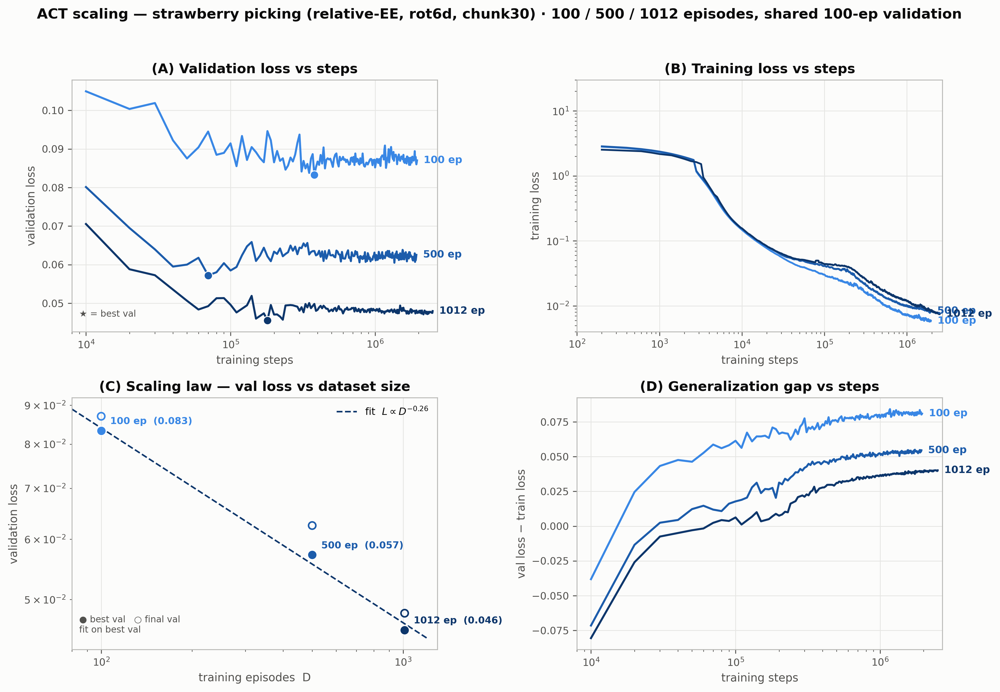
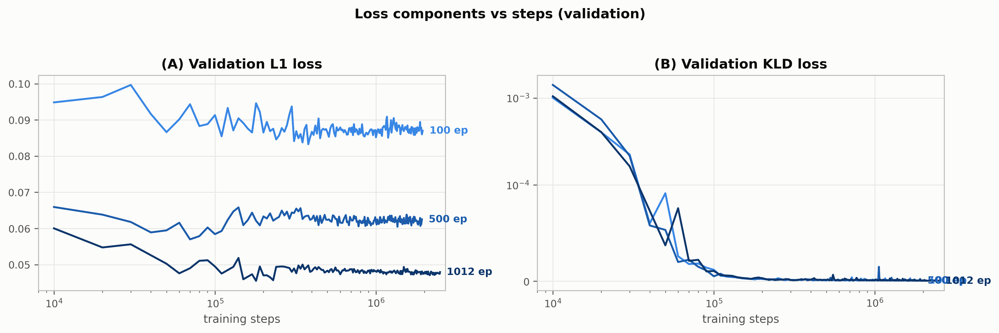

# Scaling Report — ACT, relative-EE, strawberry picking

**Question:** How does ACT validation loss scale with training-data size?
**Setup:** 3 nested train subsets — **100 / 500 / 1012 episodes** — identical ACT policy
(UMI relative-EE, rot6d, chunk30, 52M params), identical optimizer (AdamW 1e-5, batch 8),
shared **100-episode validation set**. Full method in [`EXPERIMENT.md`](EXPERIMENT.md).

> The 100-ep and 500-ep runs were **stopped early at ~1.93–1.95M steps** (out of 2.5M) once
> the result was unambiguous — both had overfit their best val by ~1.5M steps, so no signal
> was lost. Best-val is the primary metric throughout.

## Headline result

Validation loss follows a clean **power law in dataset size**:

> **L(D) ≈ 0.27 · D^(−0.26)**  &nbsp;&nbsp;(D = training episodes, fit on best val)

| episodes D | best val loss | (fit predicts) | final val loss | best-val step |
|---:|---:|---:|---:|---:|
| 100 | **0.0833** | 0.0840 | 0.0870 | 380k |
| 500 | **0.0572** | 0.0556 | 0.0625 | 70k |
| 1012 | **0.0456** | 0.0465 | 0.0480 | 180k |

Power-law predictions match all three points within ±3% (effectively exact with 3 points →
exponent **b ≈ 0.26**, episodes; **≈ 0.29** if D is measured in frames). In practical terms:
**~10× more data (100→1012 ep) roughly halves val loss (0.083→0.046)**, or each **doubling of
data cuts val loss by ~16%** (2^−0.26 ≈ 0.84).

## Figures

**Figure 1 — scaling (2×2).** (A) val loss vs steps, (B) train loss vs steps,
(C) val loss vs dataset size — log-log with power-law fit, (D) generalization gap vs steps.

**Figure 2 — loss components (validation).** L1 (left) and KLD (right) vs steps.

wandb (all grouped in `biorobotlab/lerobot_scaling_ee`):
[100ep](https://wandb.ai/biorobotlab/lerobot_scaling_ee/runs/5t50tck6) ·
[500ep](https://wandb.ai/biorobotlab/lerobot_scaling_ee/runs/454v0q73) ·
[1012ep](https://wandb.ai/biorobotlab/lerobot_scaling_ee/runs/5wkorw6c) (mirror).

## Findings

**1. Data scales — power law, with strong diminishing returns.**
Monotonic, near-perfect log-log linearity across 100→1012 ep. But the shallow exponent
(0.26) means **loss is expensive to push down**: extrapolating the fit, reaching
**L=0.04 needs ~1.6k episodes** and **L=0.03 needs ~5k** — i.e. roughly 5–15× more data
than the current 1012 set for a modest further reduction. Data alone has mostly played out
at this scale; architectural / representation gains likely dominate beyond here.

**2. Everything overfits early — the 2.5M-step budget is ~10–30× too large.**
Best validation arrives at **70k (500-ep), 180k (1012-ep), 380k (100-ep)** — then val loss
plateaus and slowly drifts up while train loss keeps dropping (memorization). For these data
scales, ~**300–500k steps** captures the achievable val loss; training to 2.5M only adds
overfit. Implication: for deployment, early-stop on val (~best-val step).

**3. Generalization gap collapses with data.**
At each run's best-val step, gap (val−train) = **0.070 (100-ep) → 0.012 (500-ep) → 0.007
(1012-ep)**. The 100-ep model memorizes its small set (train 0.006 vs val 0.083); the 1012-ep
model generalizes (train 0.008 vs val 0.046). This is the mechanism behind the scaling law:
more data shrinks the gap, which shrinks val loss. *(Panel D.)*

**4. Loss is L1-dominated; KLD vanishes (VAE posterior collapse).**
KLD → ~0 within the first ~50k steps for every run (the ACT VAE posterior collapses to the
prior), so essentially **all of val loss is L1** (reconstruction). KLD is not a useful
discriminator across data sizes here. *(Fig 2.)*

## Caveats
- **Leading-prefix subsets:** 100/500 are the *first* N episodes by session order, so at
  small N early recording sessions are over-represented (100-ep ≈ 117 frames/ep vs ≈87 for
  the full set). Fine for a nested sweep; the 100-ep point may be slightly optimistic/pessimistic
  depending on early-session difficulty.
- **3 data points** → the exponent is a rough estimate (log-linear fit on 3 points). Treat
  b≈0.26 as ±0.05.
- **Single seed per point** — no error bars; val curves are noisy (±0.005 band) but the
  inter-run gaps (0.083 / 0.057 / 0.046) far exceed the noise.
- 100/500 runs **stopped at ~1.94M**, not 2.5M (best-val fully captured earlier; see table).
- Normalization stats recomputed per subset (correct for fair comparison; means the
  MIN_MAX bounds differ slightly across runs).

## Reproduce
- Runs launched via the parent directory's `train_relative_ee_processor.py` (see
  [`EXPERIMENT.md`](EXPERIMENT.md) for the exact config & subsets).
- Figures regenerated by `make_figures.py`, which reads per-run history CSVs
  (`_{100,500,1012}_history.csv`) produced by pulling each run's metrics from wandb
  (`run.history(...)`) or parsing the run console logs. Power-law fit is a log-linear
  `np.polyfit` on best-val points.

## Bottom line
Val loss scales as a power law **L ∝ D^(−0.26)** over 100→1012 demos, halving per decade of
data. The model overfits within a few hundred k steps regardless of data size, so the
practical lever past 1k demos is no longer "more data" — returns have diminished enough that
representation/architecture changes should outperform further data collection. For this
setup, **~1012 episodes + early-stop near its best val (~180k steps) is the efficient
operating point.**

---

# 中文翻译

> 以下为原文的完整中文翻译（AI 生成）。代码块、命令、参数、路径、URL、公式和数值保持原样；正文、标题、表格说明和列表文字译为中文。

# 扩展报告 — ACT、相对末端执行器、草莓采摘

**问题：** ACT 验证损失如何随训练数据规模扩展？
**设置：** 3 个嵌套训练子集——**100 / 500 / 1012 episodes**——相同的 ACT 策略
（UMI relative-EE，rot6d，chunk30，52M 参数）、相同的优化器（AdamW 1e-5，batch 8）、
共享的 **100-episode 验证集**。完整方法见 [`EXPERIMENT.md`](EXPERIMENT.md)。

> 100-ep 和 500-ep 运行在结果已无歧义后**于约 1.93–1.95M 步提前停止**（总预算 2.5M）——两者在当时已分别比其最佳验证损失过拟合了约 1.5M 步，因此没有丢失
> 信号。全文以最佳验证损失为主要指标。

## 核心结果

验证损失随数据集规模呈现干净的**幂律**关系：

> **L(D) ≈ 0.27 · D^(−0.26)**  &nbsp;&nbsp;（D = 训练 episodes，基于最佳验证损失拟合）

| episodes D | 最佳验证损失 | （拟合预测） | 最终验证损失 | 最佳验证步数 |
|---:|---:|---:|---:|---:|
| 100 | **0.0833** | 0.0840 | 0.0870 | 380k |
| 500 | **0.0572** | 0.0556 | 0.0625 | 70k |
| 1012 | **0.0456** | 0.0465 | 0.0480 | 180k |

幂律预测在 ±3% 内匹配全部三个点（3 个点时实际上精确 → 指数 **b ≈ 0.26**，以 episodes 计；若 D 以帧计则 **≈ 0.29**）。用实际意义来说：
**约 10 倍的数据量（100→1012 ep）大致将验证损失减半（0.083→0.046）**，或者说数据每**翻倍一次，验证损失降低约 16%**（2^−0.26 ≈ 0.84）。

## 图表

**图 1 — 扩展（2×2）。** (A) 验证损失随步数变化，(B) 训练损失随步数变化，
(C) 验证损失随数据集规模变化——log-log 及幂律拟合，(D) 泛化差距随步数变化。

**图 2 — 损失分量（验证）。** L1（左）与 KLD（右）随步数变化。

wandb（全部归组于 `biorobotlab/lerobot_scaling_ee`）：
[100ep](https://wandb.ai/biorobotlab/lerobot_scaling_ee/runs/5t50tck6) ·
[500ep](https://wandb.ai/biorobotlab/lerobot_scaling_ee/runs/454v0q73) ·
[1012ep](https://wandb.ai/biorobotlab/lerobot_scaling_ee/runs/5wkorw6c)（镜像）。

## 发现

**1. 数据扩展——幂律，且收益强烈递减。**
在 100→1012 ep 范围内单调且近乎完美的 log-log 线性。但较浅的指数
（0.26）意味着**压低损失代价高昂**：外推拟合结果，达到
**L=0.04 需要约 1.6k episodes**，**L=0.03 需要约 5k**——即为了进一步的适度降低，需要比当前 1012 集多约 5–15 倍的数据。在这一规模上，仅靠数据已基本触及上限；此后的提升可能主要来自架构/表示方面的改进。

**2. 一切都很早过拟合——2.5M 步预算大约多了 10–30 倍。**
最佳验证损失分别出现在 **70k（500-ep）、180k（1012-ep）、380k（100-ep）**——随后验证损失
进入平台并缓慢上升，而训练损失持续下降（记忆化）。对于这些数据
规模，约 **300–500k 步**即可达到可实现的验证损失；训练到 2.5M 只会增加
过拟合。含义：部署时应基于验证损失早停（约在最佳验证步数）。

**3. 泛化差距随数据增加而坍缩。**
在各运行的最佳验证步数处，差距（验证−训练）= **0.070（100-ep）→ 0.012（500-ep）→ 0.007
（1012-ep）**。100-ep 模型记忆了其小数据集（训练 0.006 vs 验证 0.083）；1012-ep
模型具有泛化能力（训练 0.008 vs 验证 0.046）。这就是扩展律背后的机制：
更多数据缩小差距，从而降低验证损失。*（面板 D。）*

**4. 损失以 L1 为主；KLD 消失（VAE 后验坍缩）。**
每次运行的 KLD 在前约 50k 步内就趋于约 0（ACT VAE 后验坍缩到
先验），因此本质上**全部验证损失都是 L1**（重建）。在此，KLD 不是区分不同数据规模的有用指标。*（图 2。）*

## 注意事项
- **前导前缀子集：** 100/500 是按 session 顺序的*前* N 个 episode，因此在小 N 下早期录制 session 被过度代表（100-ep 约 117 帧/ep，而完整集约 87
  帧/ep）。对嵌套扫描而言可以接受；100-ep 那个点可能因早期 session 的难度而略微乐观/悲观。
- **3 个数据点** → 指数只是粗略估计（基于 3 个点的 log-linear 拟合）。将
  b≈0.26 视为 ±0.05。
- **每个点仅单个种子**——没有误差条；验证曲线有噪声（±0.005 带宽），但运行间差距（0.083 / 0.057 / 0.046）远超噪声。
- 100/500 运行**在约 1.94M 停止**，而非 2.5M（最佳验证损失更早已完全捕获；见表格）。
- 归一化统计量按子集重新计算（这对公平比较是正确的；这意味着
  MIN_MAX 边界在不同运行间略有差异）。

## 复现
- 运行通过父目录中的 `train_relative_ee_processor.py` 启动（确切配置与子集见
  [`EXPERIMENT.md`](EXPERIMENT.md)）。
- 图表由 `make_figures.py` 重新生成，该脚本读取每次运行的历史 CSV
  （`_{100,500,1012}_history.csv`），这些 CSV 通过从 wandb 拉取每次运行的指标
  （`run.history(...)`）或解析运行控制台日志生成。幂律拟合是对最佳验证点做的 log-linear
  `np.polyfit`。

## 结论
在 100→1012 个示教上，验证损失按幂律 **L ∝ D^(−0.26)** 扩展，数据每增加一个数量级则损失减半。无论数据规模如何，模型都会在几十万步内过拟合，因此
超过 1k 个示教后，实际的杠杆不再是“更多数据”——收益已足够递减，表示/架构的改变应当优于继续采集数据。对于此
设置，**约 1012 个 episodes + 在其最佳验证损失附近（约 180k 步）早停是高效的
运行点。**
